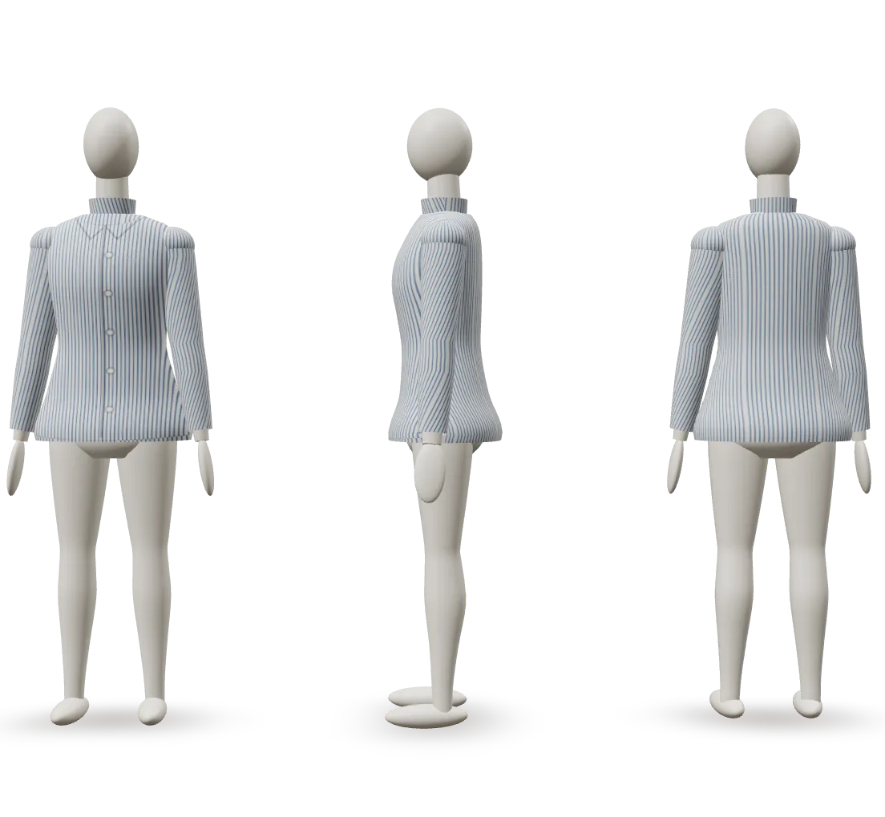
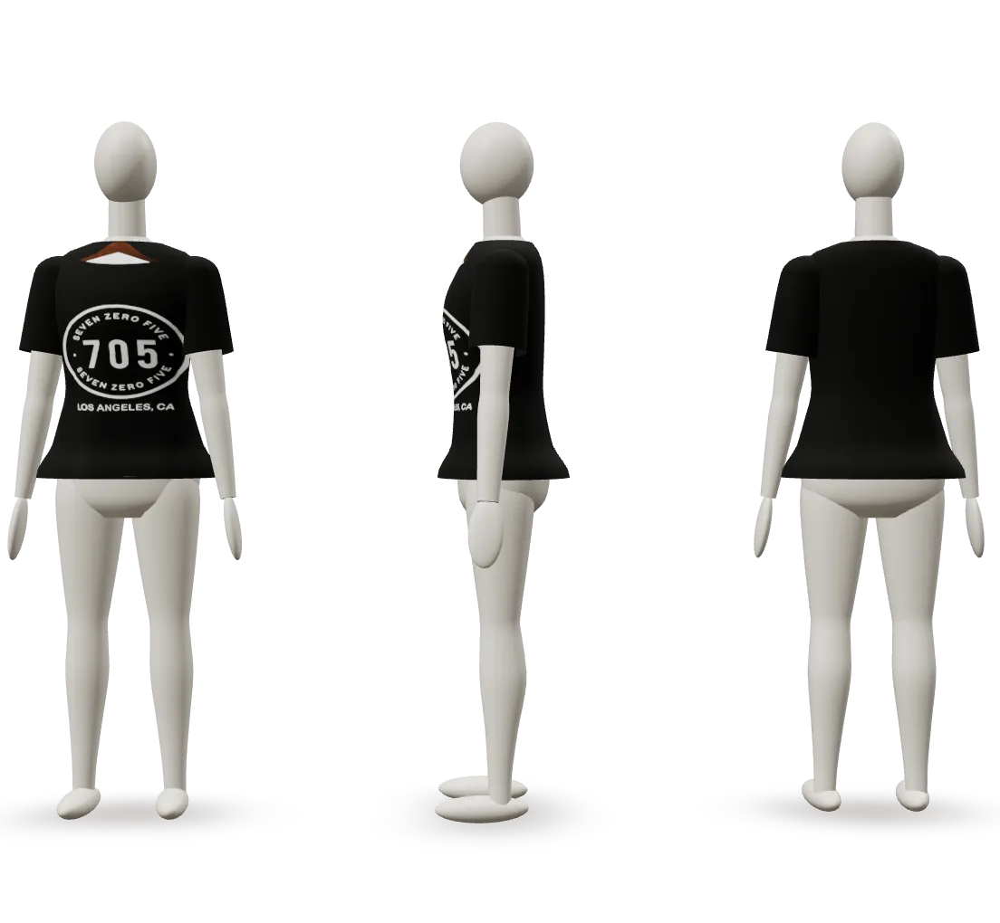
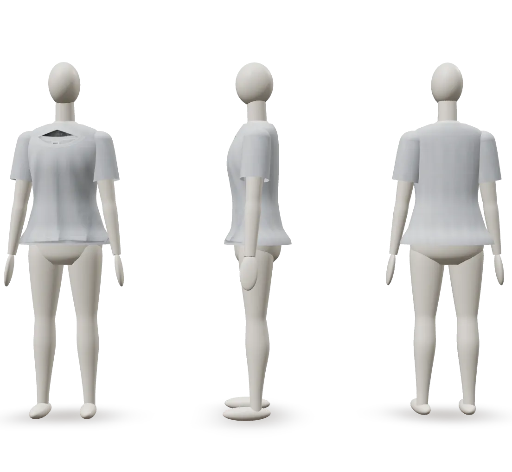
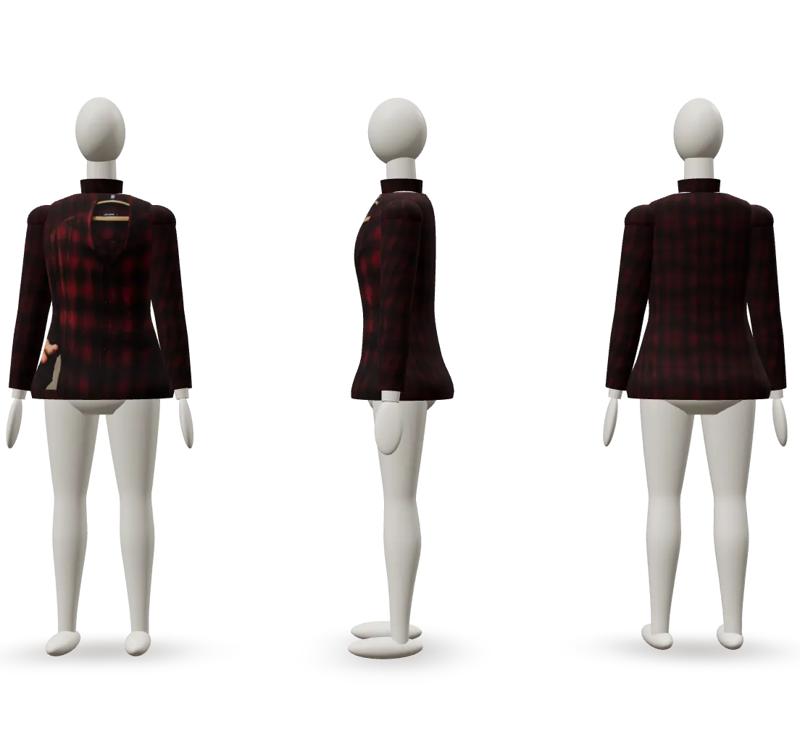
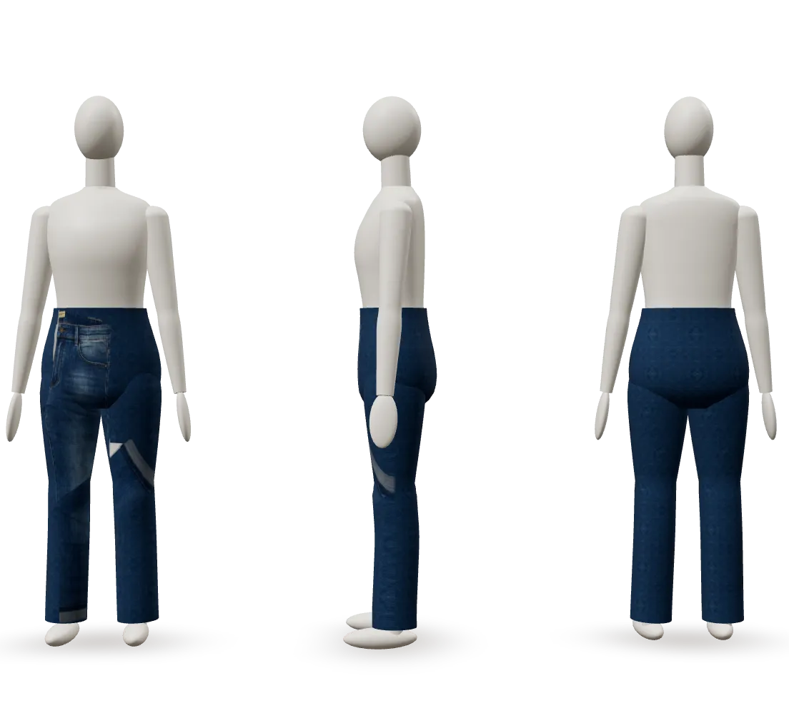
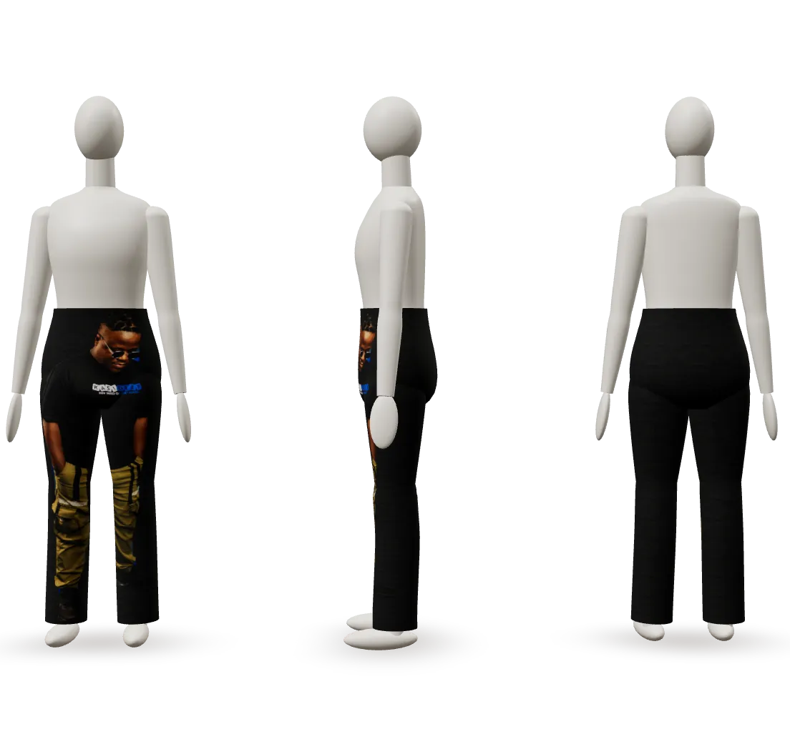

# Milestone 2: can ordinary garment photos look convincing on the templates?

_October 2026_

The blueprint called this the highest-risk assumption and asked for a test before building uploads:

> Test five varied shirts and five trousers against the chosen template mapping. If the output is not convincing, narrow the supported input contract or evaluate an existing AI try-on service.

**Verdict: keep template texturing, and narrow the input contract.** Photos that follow four simple rules look convincing, and every photo that failed broke at least one of them. AI try-on isn't needed for the MVP.

## How the test worked

Each photo goes through the mapping that uploads will use:

1. Separate the garment from the background.
2. Project the body of the garment straight onto the template's front, the way the photo was taken.
3. Tile a fabric sample over the back and sleeves.

The dev-only trial page (`npm run dev`, then `/trial.html`) shows the result on three mannequins at once: front, side and back.

The samples were:

- **7 baseline images:** the demo garments drawn as clean flat-lays on white, the best case a photo can be.
- **11 real photos from Unsplash**, chosen to cover easy and hard cases: hangers, flat-lays, folded garments, worn garments, props, busy and dark backdrops. Credits are below.

## Results

| # | Photo | Result |
| - | ----- | ------ |
| 1 | Black graphic tee on a hanger, white wall | ✅ Convincing. The print sits on the chest; the back and sleeves are plain black. |
| 2 | White tee on a hanger, concrete wall | ✅ Convincing, except a sliver of wall showing through the neck opening. |
| 3 | Red plaid shirt on a hanger, hands in the frame | 🟡 Plaid all round, plus a small skin patch where a hand covered the shirt. |
| 4 | Folded blue shirt on pink | 🟡 The fabric is right, but the folded collar lands mid-chest. |
| 5 | Jeans in the shop pose, one leg folded over | 🟡 It reads as denim, but the folded cuff shows as a pale band on the front. |
| 6 | Khaki trousers folded in half, among props | ❌ Only one leg was visible, and a camera beside it joined the crop. |
| 7 | Grey and black flannel on a black backdrop | ❌ The black checks merge into the black backdrop. |
| 8 | White tee flat on light grey | ❌ Too little contrast. It fails safely with "Couldn't find a garment in this photo." |
| 9 | Cargo trousers worn by a person, front | ❌ The whole person ended up on the trousers. |
| 10 | Cargo trousers worn, side view | ❌ Not a front view, and a person in the frame. |
| 11 | Close-up of the top of some jeans | ❌ The garment is cut off by the frame. |

All 7 baseline flat-lays were convincing from the front and plausible from the side and back.

| Baseline: generated flat-lay | 1. Graphic tee on a hanger | 2. White tee on concrete |
| --- | --- | --- |
|  |  |  |

| 3. Plaid shirt, hands in frame | 5. Jeans, folded-leg pose | 9. Trousers worn by a person |
| --- | --- | --- |
|  |  |  |

## What the trial changed

On the first pass only 2 of the 11 photos were usable. The pipeline improved in these steps:

- **Background grown in from the edges** instead of one colour threshold, so shadows and gradient backdrops don't count as garment.
- **More slack for busy backdrops**, measured from how much the photo's edges vary, which fixed the concrete wall.
- **Only the largest garment patch kept**, and the mask tidied up to drop hooks, rails and props.
- **Fabric sample picked by content**: the patch closest to the garment's dominant colour, so prints and hands aren't tiled over the back.
- **The sample's lighting evened out** so folds don't repeat as a pattern.
- **Edge trimming and pattern fill** (from the baseline run), so there are no pale outlines and no flat patches in gaps.

## The input contract for uploads

These four rules separate every pass from every failure above:

1. **One garment, front facing, all of it in the frame.**
2. **Laid flat or on a hanger**, not folded and not worn.
3. **A plain background that contrasts with the garment**: dark clothes on a light surface, light clothes on a dark one.
4. **Nothing else in the shot**, so no hands, props or other clothes.

### What Milestone 3 should do with this

- Show the four rules, with a good and a bad example, right where people upload.
- Never accept a photo silently. Show what the mapping found, as the trial page does: the crop, the fabric sample, and a front, side and back preview. Then let the person confirm, re-crop, change the template or adjust the background tolerance.
- Refuse photos where no garment is found or coverage is low, and say why, rather than dressing the mannequin in a bad result.

## Known issues to fix next

- A backdrop visible through a neck opening (photo 2) is kept as garment. The fix needs care: a white print on a black tee looks just like a white wall through the neck.
- Hangers sometimes show at the collar.
- Back and sleeves are always a tiled sample. That's honest, but large prints and big checks repeat visibly.
- The procedural mannequin's shoulder caps still make shirts look a little padded.

## Later, if the contract proves too strict

On-device background removal (an image segmentation model running in the browser) could accept busier photos, such as dark-on-dark, cluttered or worn shots, without a server or paid API. Worth evaluating if real users struggle with rule 3 or 4. Generated AI try-on would make flat images that can't be turned around, so it doesn't fit the 3D viewer.

## Photo credits

All from [Unsplash](https://unsplash.com) under the free Unsplash License. The photos stay out of the repo; the result images above are renders of the mapped garments.

1. [Ryan Hoffman](https://unsplash.com/photos/u6n1HrW0sdQ)
2. [Haryo Setyadi](https://unsplash.com/photos/acn5ERAeSb4)
3. [Yap](https://unsplash.com/photos/Kvu8S9HlvcA)
4. [Background Foto Pixell Design](https://unsplash.com/photos/OsvD4y41C4g)
5. [TuanAnh Blue](https://unsplash.com/photos/9yoXrG6Er_g)
6. [Jake Weirick](https://unsplash.com/photos/FweCLUJEHMc)
7. [Caio Coelho](https://unsplash.com/photos/xFmXLq_KJxg)
8. [mockupbee](https://unsplash.com/photos/4rUYuwJ2vGw)
9. [DJ Tears PLK](https://unsplash.com/photos/5X7iTxmiuQk)
10. [engin akyurt](https://unsplash.com/photos/UrKqhKvHcrw)
11. [Matthew Moloney](https://unsplash.com/photos/Te7qwZmbqWU)
